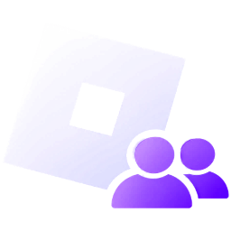

<h1 align="center">Multi Manager Roblox</h1>

Run several Roblox clients side by side, each signed in as a different account. 
<b>v1.0.0</b> · Windows 10 / 11 · <a href="https://b-loom.github.io/Multi-Manager-Roblox/">Website</a> · <a href="CHANGELOG.md">Changelog</a> · <a href="LICENSE">MIT license</a>

<a href="#français">🇫🇷 Version française plus bas</a>

> [!CAUTION]
> ## ⚠️ USE AT YOUR OWN RISK
> **The author of this repository is NOT responsible for anything that happens from using this software:** account bans or restrictions, data loss, crashes or any other damage. **Roblox does not officially support running several clients at once.** The software is provided "as is", without any warranty.
>
> **🤖 Made by AI:** all the changes in Multi Manager Roblox were **created by Claude**, Anthropic's AI assistant.
>
> **📦 Not an original project:** it is a modified version of **RoRoRo** by 626 Labs → https://github.com/estevanhernandez-stack-ed/ROROROblox

> [!CAUTION]
> ## ⚠️ UTILISATION À VOS RISQUES
> **L'auteur de ce dépôt N'EST PAS responsable de ce qui peut arriver en utilisant ce logiciel :** bannissement ou restriction de compte, perte de données, plantage ou tout autre dommage. **Roblox ne prend pas officiellement en charge plusieurs clients en même temps.** Le logiciel est fourni « tel quel », sans aucune garantie.
>
> **🤖 Créé par une IA :** toutes les modifications de Multi Manager Roblox ont été **créées par Claude**, l'assistant IA d'Anthropic.
>
> **📦 Pas un projet original :** c'est une version modifiée de **RoRoRo** de 626 Labs → https://github.com/estevanhernandez-stack-ed/ROROROblox

---

## English

### What it does

- **Multi-instance**: open as many Roblox clients as you want at the same time.
- **Accounts**: save several Roblox accounts, give them names, launch each one in its own client.
- **Library**: save games and private servers, launch an account straight into them.
- **Squad Launch**: launch several accounts one after another.
- **History, Diagnostics, Plugins**: all inside the main window, from the sidebar.
- **Two languages**: English or French, chosen at first launch (changeable in Settings).
- **Galaxy theme**: violet palette, nebula glows and a starfield.

### Install

1. Download **[MultiManagerRoblox-win-Setup.exe](https://github.com/B-loom/Multi-Manager-Roblox/releases/latest/download/MultiManagerRoblox-win-Setup.exe)** (latest release).
2. Run it. Windows SmartScreen may warn you because the app is not signed with a paid certificate: click **More info**, then **Run anyway**.
3. The app installs and opens by itself. New versions are offered inside the app.

To build from source instead: install the [.NET 10 SDK](https://dotnet.microsoft.com/download), then run `dotnet build ROROROblox.slnx -c Release`.

### Uninstall

1. Quit the app, including its icon next to the clock (right-click → Quit).
2. Open **Windows Settings → Apps → Installed apps**, find **Multi Manager Roblox**, then **⋯ → Uninstall**.
   - Not in the list? Close Settings completely and reopen it, or press **Win + R**, type `appwiz.cpl` and press Enter.
   - Or press **Win + R** and run: `"%LOCALAPPDATA%\MultiManagerRoblox\Update.exe" --uninstall`
3. Your accounts and settings stay in `%LOCALAPPDATA%\ROROROblox`. Delete that folder too to remove everything (it is shared with RoRoRo if you also use it).

### Use

1. On first launch, pick **English** or **Français**.
2. **+ Add account**: sign in on the official Roblox login page. Your password is never stored by the app.
3. Click **Launch** on an account. Repeat with other accounts: every client stays open.
4. Use the sidebar to reach the Library, Settings, History and the other pages.

### Security

- Sign-in happens on Roblox's own page. Session cookies are encrypted with Windows DPAPI and stay on your PC.
- Nothing is sent to a third-party server.
- Multi-instance works by holding Roblox's single-instance lock. Roblox does not officially support this, and an update of the Roblox client can break it.

### Disclaimer

- **Use at your own risk.** The author of this repository is not responsible for anything that happens from using this software: account bans or restrictions, data loss, crashes or any other damage. The software is provided "as is", without warranty of any kind (see the [MIT license](LICENSE)).
- **Made with AI.** All the changes in Multi Manager Roblox (galaxy theme, sidebar, embedded pages, language picker, logo integration, docs and website) were created by Claude, Anthropic's AI assistant.

### Credits

The original project is **RoRoRo** by 626 Labs: https://github.com/estevanhernandez-stack-ed/ROROROblox (MIT license). Multi Manager Roblox is a modified version of it. Not affiliated with Roblox Corporation. Roblox is a trademark of Roblox Corporation.

---

## Français

### Ce que fait l'application

- **Multi-instance** : ouvrez autant de clients Roblox que vous voulez en même temps.
- **Comptes** : enregistrez plusieurs comptes Roblox, nommez-les, lancez chacun dans son propre client.
- **Bibliothèque** : enregistrez des jeux et des serveurs privés, lancez un compte directement dedans.
- **Lancement en équipe** : lancez plusieurs comptes l'un après l'autre.
- **Historique, Diagnostics, Plugins** : tout s'ouvre dans la fenêtre principale, depuis la barre latérale.
- **Deux langues** : anglais ou français, choisi au premier lancement (modifiable dans Paramètres).
- **Thème Galaxy** : palette violette, nébuleuses et fond étoilé.

### Installation

1. Téléchargez **[MultiManagerRoblox-win-Setup.exe](https://github.com/B-loom/Multi-Manager-Roblox/releases/latest/download/MultiManagerRoblox-win-Setup.exe)** (dernière version).
2. Lancez-le. Windows SmartScreen peut afficher un avertissement car l'application n'est pas signée avec un certificat payant : cliquez sur **Informations complémentaires**, puis **Exécuter quand même**.
3. L'application s'installe et s'ouvre toute seule. Les nouvelles versions vous sont proposées dans l'application.

Pour compiler depuis le code source : installez le [SDK .NET 10](https://dotnet.microsoft.com/download), puis lancez `dotnet build ROROROblox.slnx -c Release`.

### Désinstallation

1. Quittez l'application, y compris son icône près de l'horloge (clic droit → Quitter).
2. Ouvrez **Paramètres Windows → Applications → Applications installées**, cherchez **Multi Manager Roblox**, puis **⋯ → Désinstaller**.
   - Pas dans la liste ? Fermez complètement Paramètres et rouvrez-le, ou faites **Win + R**, tapez `appwiz.cpl` puis Entrée.
   - Ou faites **Win + R** et lancez : `"%LOCALAPPDATA%\MultiManagerRoblox\Update.exe" --uninstall`
3. Vos comptes et réglages restent dans `%LOCALAPPDATA%\ROROROblox`. Supprimez aussi ce dossier pour tout effacer (il est partagé avec RoRoRo si vous l'utilisez aussi).

### Utilisation

1. Au premier lancement, choisissez **English** ou **Français**.
2. **+ Ajouter un compte** : connectez-vous sur la page officielle de Roblox. L'application ne stocke jamais votre mot de passe.
3. Cliquez sur **Lancer** sur un compte. Recommencez avec d'autres comptes : chaque client reste ouvert.
4. Utilisez la barre latérale pour accéder à la Bibliothèque, aux Paramètres, à l'Historique et aux autres pages.

### Sécurité

- La connexion se fait sur la page de Roblox. Les cookies de session sont chiffrés avec Windows DPAPI et restent sur votre PC.
- Rien n'est envoyé à un serveur tiers.
- Le multi-instance fonctionne en réservant le verrou d'instance unique de Roblox. Roblox ne le prend pas officiellement en charge, et une mise à jour du client peut le casser.

### Avertissement

- **Utilisation à vos risques.** L'auteur de ce dépôt n'est responsable de rien de ce qui peut arriver en utilisant ce logiciel : bannissement ou restriction de compte, perte de données, plantage ou tout autre dommage. Le logiciel est fourni « tel quel », sans aucune garantie (voir la [licence MIT](LICENSE)).
- **Créé avec une IA.** Toutes les modifications de Multi Manager Roblox (thème galaxy, barre latérale, pages intégrées, choix de la langue, intégration du logo, documentation et site) ont été créées par Claude, l'assistant IA d'Anthropic.

### Crédits

Le projet original est **RoRoRo** de 626 Labs : https://github.com/estevanhernandez-stack-ed/ROROROblox (licence MIT). Multi Manager Roblox en est une version modifiée. Non affilié à Roblox Corporation. Roblox est une marque de Roblox Corporation.
